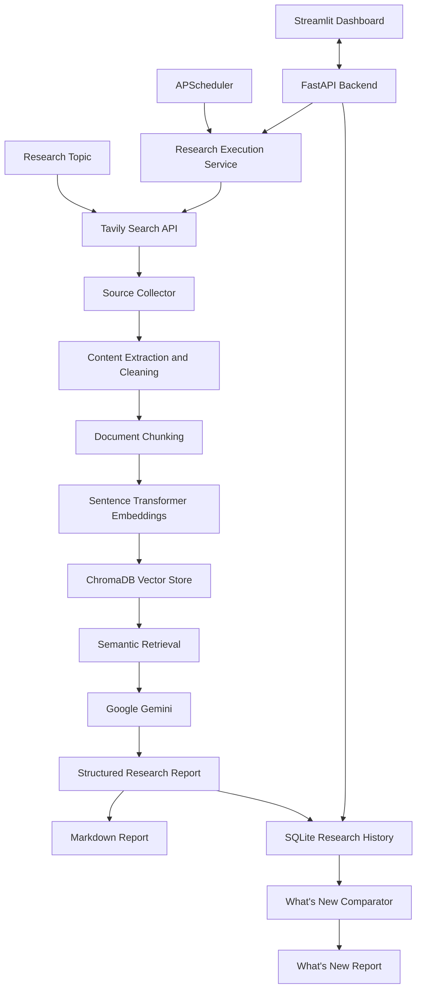

# AutoResearch AI

### AI-Powered Research Automation with Retrieval-Augmented Generation (RAG)

AutoResearch AI is an intelligent research automation agent that transforms user-defined topics into structured research reports grounded in information collected from the web. It combines automated source discovery, webpage content extraction, semantic retrieval, large language model synthesis, persistent research history, and scheduled execution in one Python application.

The system also compares new research with previous runs to identify new findings, changed findings, and newly discovered sources.

## Features

- **Automated Web Research:** Discover relevant web sources using the Tavily Search API.
- **Webpage Collection and Cleaning:** Fetch web pages, extract useful text, and remove unnecessary HTML elements.
- **Retrieval-Augmented Generation (RAG):** Split content into overlapping chunks, generate embeddings, store vectors in ChromaDB, and retrieve semantically relevant passages.
- **AI-Powered Research Reports:** Use Google Gemini to generate structured Markdown reports containing an executive summary, key findings, detailed analysis, emerging trends, conclusions, and source references.
- **Source Citation Management:** Associate citation IDs such as `[S1]` and `[S2]` with source metadata and deduplicate repeated canonical source URLs.
- **Persistent Research Memory:** Store research runs, findings, and source associations in SQLite.
- **What's New Analysis:** Compare fresh research against previous runs to identify new findings, changed findings, new sources, and already-known information.
- **Scheduled Research Automation:** Configure recurring research jobs using APScheduler.
- **Research Job Management:** Track job status, timestamps, errors, research-run associations, and generated report paths.
- **Interactive Dashboard:** Use Streamlit to submit research topics, browse history, compare findings, view reports, and manage schedules.
- **REST API:** Access research and job-management functions through FastAPI and interactive API documentation.

## Technology Stack

| Component | Technology |
|---|---|
| Programming Language | Python |
| Large Language Model | Google Gemini API (`google-genai`) |
| Web Search | Tavily Search API |
| Web Content Extraction | Requests, BeautifulSoup |
| Text Embeddings | Sentence Transformers |
| Embedding Model | `all-MiniLM-L6-v2` |
| Vector Database | ChromaDB |
| Research History and Job Persistence | SQLite |
| Backend API | FastAPI, Uvicorn |
| Frontend Dashboard | Streamlit |
| Task Scheduling | APScheduler |
| Environment Configuration | python-dotenv |
| Automated Testing | pytest |
| Report Format | Markdown |

## System Architecture



## Research Workflow

1. **Topic Input:** The user enters a research topic through the command line or Streamlit dashboard.

2. **Source Discovery:** Tavily searches the web and returns relevant source metadata and URLs.

3. **Content Collection:** The source collector fetches webpages and extracts useful text for processing.

4. **Document Chunking:** The extracted content is divided into overlapping text segments.

5. **Embedding Generation:** Sentence Transformers converts text chunks into vector embeddings.

6. **Vector Storage and Retrieval:** ChromaDB stores and indexes embeddings, enabling semantic retrieval of relevant passages.

7. **AI Research Synthesis:** Google Gemini uses the research topic and retrieved context to generate a structured research response with source references.

8. **Report Generation:** The research report is saved locally in Markdown format.

9. **Research Memory:** SQLite stores previous research runs, findings, and source associations.

10. **What's New Comparison:** A subsequent research run can be compared with earlier findings to identify new information and changes.

11. **Scheduled Execution:** APScheduler triggers configured research jobs, while the job-management service tracks their execution.

## Project Structure

```text
AutoResearch-AI/
├── app/
│   ├── api/
│   │   ├── main.py
│   │   ├── models.py
│   │   └── routes/
│   │       ├── history.py
│   │       ├── jobs.py
│   │       ├── research.py
│   │       ├── schedules.py
│   │       └── whats_new.py
│   ├── llm/
│   │   └── client.py
│   ├── memory/
│   │   ├── comparator.py
│   │   ├── database.py
│   │   ├── models.py
│   │   └── repository.py
│   ├── rag/
│   │   ├── chunker.py
│   │   ├── embeddings.py
│   │   ├── service.py
│   │   └── vector_store.py
│   ├── research/
│   │   ├── agent.py
│   │   ├── prompts.py
│   │   └── report.py
│   ├── scheduler/
│   ├── search/
│   │   ├── collector.py
│   │   ├── models.py
│   │   └── tavily_client.py
│   ├── services/
│   │   └── research_service.py
│   ├── ui/
│   │   └── streamlit_app.py
│   ├── config.py
│   └── main.py
├── data/                 # Local database and vector-store data
├── reports/              # Generated Markdown research reports
├── tests/                # Automated test suite
├── .env.example
├── .gitignore
├── requirements.txt
├── run.py
└── README.md
```

## Getting Started

### Prerequisites

- Python installed and available on your PATH
- Git
- Google Gemini API key
- Tavily Search API key

### 1. Clone the Repository

```bash
git clone https://github.com/DSUCS0018/AutoResearch-AI.git
cd AutoResearch-AI
```

### 2. Create and Activate a Virtual Environment

**Windows PowerShell**

```powershell
python -m venv .venv
.\.venv\Scripts\Activate.ps1
```

If PowerShell activation is restricted, invoke the virtual environment's Python executable directly.

**macOS / Linux**

```bash
python3 -m venv .venv
source .venv/bin/activate
```

### 3. Install Dependencies

```bash
python -m pip install -r requirements.txt
```

### 4. Configure Environment Variables

Create a local `.env` file using the example configuration.

**Windows PowerShell**

```powershell
Copy-Item .env.example .env
```

**macOS / Linux**

```bash
cp .env.example .env
```

Add your API credentials and application settings to `.env`.

| Variable | Description |
|---|---|
| `APP_NAME` | Application display name |
| `APP_VERSION` | Application version |
| `ENVIRONMENT` | Runtime environment |
| `LOG_LEVEL` | Logging verbosity |
| `GEMINI_API_KEY` | Google Gemini API credential |
| `GEMINI_MODEL` | Gemini model name |
| `TAVILY_API_KEY` | Tavily Search API credential |
| `TAVILY_MAX_RESULTS` | Maximum search results per query |
| `EMBEDDING_MODEL` | Sentence Transformers embedding model |
| `CHROMA_PERSIST_DIRECTORY` | ChromaDB persistence directory |
| `CHUNK_SIZE` | Document chunk size |
| `CHUNK_OVERLAP` | Overlap between document chunks |
| `TOP_K` | Number of relevant chunks retrieved |
| `SCHEDULER_TIMEZONE` | Time zone used for scheduling |

Use the settings and defaults defined in `.env.example` and `app/config.py`. Never commit API keys or your local `.env` file.

## Usage

Run commands from the project root with the virtual environment activated.

### Run Research

```bash
python run.py --research "latest developments in artificial intelligence"
```

This executes the research pipeline and saves the generated Markdown report in the `reports/` directory.

### View Research History

```bash
python run.py --history "latest developments in artificial intelligence"
```

Displays previously stored research runs associated with the specified topic.

### Identify What's New

```bash
python run.py --whats-new "latest developments in artificial intelligence"
```

Performs fresh research and compares its findings with previous research for the topic.

### Test Individual Components

Test the Gemini connection:

```bash
python run.py --test-llm
```

Test web search and source collection:

```bash
python run.py --test-search
```

Test the RAG pipeline:

```bash
python run.py --test-rag
```

Test research memory and comparison:

```bash
python run.py --test-memory
```

Test the scheduler:

```bash
python run.py --test-scheduler
```

The integration tests require valid configuration where live external services are involved.

## Web Application

AutoResearch AI provides a FastAPI backend and a Streamlit dashboard.

### 1. Start the Backend

```bash
python run.py --api
```

The local backend is available at:

- **API Base URL:** `http://localhost:8000`
- **Interactive API Documentation:** `http://localhost:8000/docs`
- **Health Check:** `http://localhost:8000/health`

### 2. Start the Dashboard

Open a second terminal, activate the same virtual environment, and run:

```bash
python -m streamlit run app/ui/streamlit_app.py
```

Open the URL printed in the terminal, typically:

`http://localhost:8501`

Keep the FastAPI backend running while using dashboard features that depend on the API.

### 3. Dashboard Features

- **Research:** Submit a topic and generate a research report.
- **History:** Browse previously stored research runs.
- **What's New:** Compare fresh findings with earlier research.
- **Schedules:** Create, view, enable, disable, run, or remove scheduled research tasks.
- **Jobs:** Monitor research job status and inspect associated reports and execution details.

## Scheduled Research

APScheduler supports configurable recurring research jobs.

### Start the Scheduler

```bash
python run.py --scheduler
```

### Add a Daily Schedule

```bash
python run.py --schedule-add "AI research updates" --daily 09:00
```

### Add a Weekly Schedule

The following example schedules research for Mondays at 09:00.

```bash
python run.py --schedule-add "AI research updates" --weekly monday 09:00
```

### List Schedules

```bash
python run.py --schedule-list
```

### Run a Schedule Immediately

```bash
python run.py --schedule-run <job_id>
```

### Enable or Disable a Schedule

```bash
python run.py --schedule-enable <job_id>
python run.py --schedule-disable <job_id>
```

### Remove a Schedule

```bash
python run.py --schedule-remove <job_id>
```

Replace `<job_id>` with the ID associated with the schedule.

## REST API

The FastAPI backend exposes endpoints for research execution and job management.

| Method | Endpoint | Description |
|---|---|---|
| `POST` | `/api/research` | Submit a research request |
| `POST` | `/api/jobs` | Create a research job |
| `GET` | `/api/jobs` | List research jobs |
| `GET` | `/api/jobs/{job_id}` | Retrieve job details |
| `GET` | `/api/jobs/{job_id}/status` | Retrieve job execution status |
| `GET` | `/api/jobs/{job_id}/reports` | Retrieve associated report information |
| `GET` | `/health` | Check backend health |
| `GET` | `/docs` | Explore the API interactively |

The interactive documentation at `/docs` provides the request schemas and available routes.

## Research Reports

Generated reports are stored as Markdown files in the `reports/` directory.

A typical research report contains:

- Research topic and generation timestamp
- Executive summary
- Key findings
- Detailed analysis
- Emerging trends
- Conclusion
- Source references

The What's New workflow generates a separate comparison report containing new findings, changed findings, newly discovered sources, and previously known information.

## Automated Testing

Run the automated test suite from the project root:

```bash
python -m pytest -q
```

The recorded test run completed with **134 passing tests**. Relevant tests mock external API interactions so application behavior can be tested without making live requests. Running the suite in your own environment allows you to reproduce the result.

## Security

- Store API credentials in `.env`.
- Keep `.env` and other secrets out of version control.
- Use placeholder values in `.env.example`.
- Exclude virtual environments, local databases, vector-store files, logs, and private runtime data from public commits.
- Revoke and rotate any credential that has been exposed in a repository or its Git history.

## Summary

AutoResearch AI combines automated web discovery, RAG-based context retrieval, Gemini-powered research synthesis, source-referenced reporting, persistent research memory, What's New comparison, and scheduled execution. Its FastAPI backend and Streamlit dashboard provide API-based and interactive access to the research workflow.
