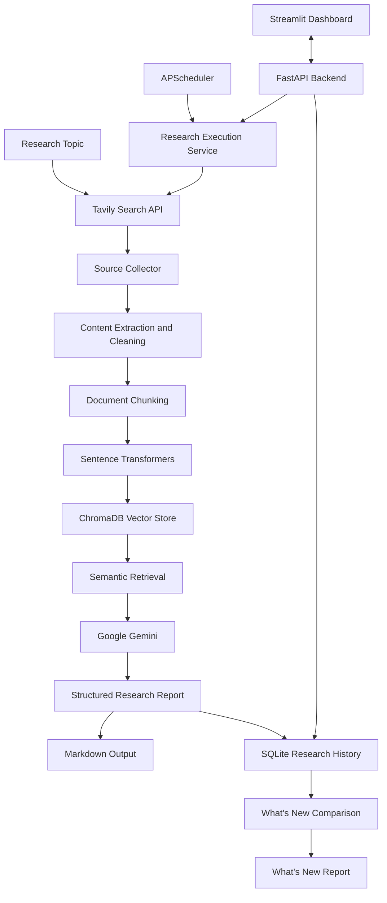

# AutoResearch AI

### AI-Powered Research Automation with Retrieval-Augmented Generation (RAG)

AutoResearch AI is a research automation agent that turns a user-defined topic into a structured research report grounded in information collected from the web. It combines automated source discovery, webpage content extraction, semantic retrieval, large language model synthesis, persistent research history, and scheduled execution in one Python application.

The system also compares new research with previous runs to highlight new findings, changed findings, and newly discovered sources.

## Features

- **Automated web research:** Discover relevant web sources using the Tavily Search API.
- **Webpage collection and cleaning:** Fetch pages and extract useful text for research.
- **Retrieval-Augmented Generation (RAG):** Split content into overlapping chunks, generate embeddings, store vectors in ChromaDB, and retrieve semantically relevant passages.
- **AI-generated reports:** Use Google Gemini to produce structured Markdown reports with an executive summary, key findings, analysis, emerging trends, conclusion, and sources.
- **Source reference management:** Associate citation IDs such as `[S1]` and `[S2]` with source metadata and deduplicate repeated canonical URLs.
- **Persistent research memory:** Store research runs, findings, and source associations in SQLite.
- **What's New comparison:** Compare fresh research with previous results to identify new findings, changed findings, new sources, and already-known information.
- **Scheduled research:** Configure recurring daily or weekly research using APScheduler.
- **Job tracking:** Track execution status, timestamps, errors, research-run associations, and report paths.
- **Interactive dashboard:** Use Streamlit to submit research topics, browse history, compare findings, view reports, and manage schedules.
- **REST API:** Access research and job-management functionality through FastAPI and interactive API documentation.

## Technology Stack

| Component | Technology |
|---|---|
| Language | Python |
| LLM | Google Gemini API (`google-genai`) |
| Web search | Tavily Search API |
| Web content extraction | Requests, BeautifulSoup |
| Text embeddings | Sentence Transformers |
| Embedding model | `all-MiniLM-L6-v2` |
| Vector database | ChromaDB |
| Research history and job persistence | SQLite |
| Backend API | FastAPI, Uvicorn |
| Dashboard | Streamlit |
| Scheduling | APScheduler |
| Configuration | python-dotenv |
| Testing | pytest |
| Reports | Markdown |

## How It Works

1. **Topic input:** The user submits a research topic through the command line or dashboard.
2. **Source discovery:** Tavily searches the web and returns relevant source metadata.
3. **Content collection:** The collector fetches webpages and extracts useful text.
4. **Chunking:** The content is divided into overlapping text segments.
5. **Embedding and indexing:** Sentence Transformers generates embeddings, which are stored in ChromaDB.
6. **Semantic retrieval:** Relevant passages are retrieved for the research topic.
7. **LLM synthesis:** Google Gemini uses the topic and retrieved context to produce a structured research report.
8. **Report generation:** The report is saved as a Markdown file with source references.
9. **Research memory:** The run and related findings and sources are stored in SQLite.
10. **Change detection:** A later run can be compared with previous research to generate a What's New report.
11. **Automation and access:** APScheduler can trigger research jobs, while FastAPI and Streamlit provide API and dashboard access.

## Architecture



## Project Structure

```text
AutoResearch-AI/
├── app/
│   ├── api/
│   │   ├── main.py
│   │   ├── models.py
│   │   └── routes/
│   ├── llm/
│   │   └── client.py
│   ├── memory/
│   │   ├── comparator.py
│   │   ├── database.py
│   │   ├── models.py
│   │   └── repository.py
│   ├── rag/
│   │   ├── chunker.py
│   │   ├── embeddings.py
│   │   ├── service.py
│   │   └── vector_store.py
│   ├── research/
│   │   ├── agent.py
│   │   ├── prompts.py
│   │   └── report.py
│   ├── scheduler/
│   ├── search/
│   │   ├── collector.py
│   │   ├── models.py
│   │   └── tavily_client.py
│   ├── services/
│   │   └── research_service.py
│   ├── ui/
│   │   └── streamlit_app.py
│   ├── config.py
│   └── main.py
├── data/                 # Local database and vector-store data
├── reports/              # Generated Markdown reports
├── tests/                # Automated tests
├── .env.example
├── .gitignore
├── requirements.txt
├── run.py
└── README.md
```

## Getting Started

### Prerequisites

- Python installed and available on your PATH
- Git
- A Google Gemini API key
- A Tavily Search API key

### 1. Clone the repository

```bash
git clone https://github.com/DSUCS0018/AutoResearch-AI.git
cd AutoResearch-AI
```

### 2. Create and activate a virtual environment

**Windows PowerShell**

```powershell
python -m venv .venv
.\.venv\Scripts\Activate.ps1
```

If PowerShell activation is restricted, you can run commands using ` .\.venv\Scripts\python.exe` directly.

**macOS / Linux**

```bash
python3 -m venv .venv
source .venv/bin/activate
```

### 3. Install dependencies

```bash
python -m pip install -r requirements.txt
```

### 4. Configure environment variables

Create a local `.env` file from the example:

**Windows PowerShell**

```powershell
Copy-Item .env.example .env
```

**macOS / Linux**

```bash
cp .env.example .env
```

Set your credentials and application settings in `.env`. Do not commit this file or publish API keys.

| Variable | Purpose |
|---|---|
| `GEMINI_API_KEY` | Google Gemini API credential |
| `GEMINI_MODEL` | Gemini model name |
| `TAVILY_API_KEY` | Tavily Search API credential |
| `TAVILY_MAX_RESULTS` | Maximum search results per query |
| `APP_NAME` | Application display name |
| `APP_VERSION` | Application version |
| `ENVIRONMENT` | Runtime environment |
| `LOG_LEVEL` | Logging verbosity |
| `EMBEDDING_MODEL` | Sentence Transformers model |
| `CHROMA_PERSIST_DIRECTORY` | Local ChromaDB persistence path |
| `CHUNK_SIZE` | Text chunk size |
| `CHUNK_OVERLAP` | Overlap between chunks |
| `TOP_K` | Number of relevant chunks retrieved |
| `SCHEDULER_TIMEZONE` | Time zone used for scheduled jobs |

The project's `.env.example` and `app/config.py` define the available settings and defaults.

## Usage

Run commands from the project root with the virtual environment active.

### Run a research task

```bash
python run.py --research "latest developments in artificial intelligence"
```

This runs the research pipeline and saves the generated Markdown report under `reports/`.

### View research history

```bash
python run.py --history "latest developments in artificial intelligence"
```

Displays stored research history for the specified topic.

### Identify what's new

```bash
python run.py --whats-new "latest developments in artificial intelligence"
```

Performs fresh research and compares its findings with previously stored research for the topic.

### Start the FastAPI backend

```bash
python run.py --api
```

The local backend is available at:

- API base URL: `http://localhost:8000`
- Swagger UI: `http://localhost:8000/docs`
- Health check: `http://localhost:8000/health`

### Start the Streamlit dashboard

Open a second terminal, activate the same virtual environment, and run:

```bash
python -m streamlit run app/ui/streamlit_app.py
```

Open the URL shown in the terminal, usually `http://localhost:8501`. Keep the FastAPI backend running when using dashboard functions that call the API.

### Run the scheduler

To start the scheduler process:

```bash
python run.py --scheduler
```

### Manage schedules from the command line

Add a daily schedule:

```bash
python run.py --schedule-add "AI research updates" --daily 09:00
```

Add a weekly schedule (example: Mondays at 09:00):

```bash
python run.py --schedule-add "AI research updates" --weekly monday 09:00
```

List configured schedules:

```bash
python run.py --schedule-list
```

Run a schedule immediately:

```bash
python run.py --schedule-run <job_id>
```

Enable or disable a schedule:

```bash
python run.py --schedule-enable <job_id>
python run.py --schedule-disable <job_id>
```

Remove a schedule:

```bash
python run.py --schedule-remove <job_id>
```

Replace `<job_id>` with the ID returned by the application.

### Test individual components

```bash
python run.py --test-llm
python run.py --test-search
python run.py --test-rag
python run.py --test-memory
python run.py --test-scheduler
```

These commands exercise individual components. Integration tests for external services require valid credentials.

## API Endpoints

The FastAPI backend includes endpoints for research and job management.

| Method | Endpoint | Purpose |
|---|---|---|
| `POST` | `/api/research` | Submit a research request |
| `POST` | `/api/jobs` | Create a research job |
| `GET` | `/api/jobs` | List research jobs |
| `GET` | `/api/jobs/{job_id}` | Retrieve job details |
| `GET` | `/api/jobs/{job_id}/status` | Retrieve job status |
| `GET` | `/api/jobs/{job_id}/reports` | Retrieve report information |
| `GET` | `/health` | Check backend health |
| `GET` | `/docs` | Interactive API documentation |

The running API documentation at `/docs` lists the available routes and request schemas.

## Research Reports

Research outputs are saved as Markdown files in the `reports/` directory. A typical report includes:

- Research topic and generation timestamp
- Executive summary
- Key findings
- Detailed analysis
- Emerging trends
- Conclusion
- Sources and citation references

What's New reports summarize the comparison between current and previously stored findings.

## Automated Testing

Run the test suite from the project root:

```bash
python -m pytest -q
```

The recorded test run completed with **134 passing tests**. Relevant tests mock external API calls so they can validate application behavior without making real requests. Run the tests against your current checkout to reproduce the result.

## Security

- Keep API keys in the local `.env` file.
- Use placeholder values in `.env.example`; never store working credentials in source control.
- Keep virtual environments, local databases, vector-store artifacts, logs, and private data out of public commits.
- If a credential has ever been committed, revoke or rotate it; deleting it from the latest version alone does not invalidate it.

## Summary

AutoResearch AI brings together automated web discovery, RAG-based context retrieval, Gemini-powered synthesis, source-referenced reporting, persistent research history, What's New comparison, and scheduled execution. Its FastAPI backend and Streamlit dashboard make the research workflow accessible through both an API and an interactive interface.
